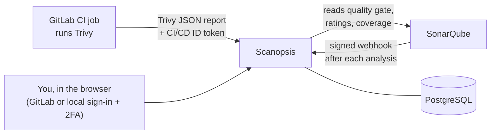
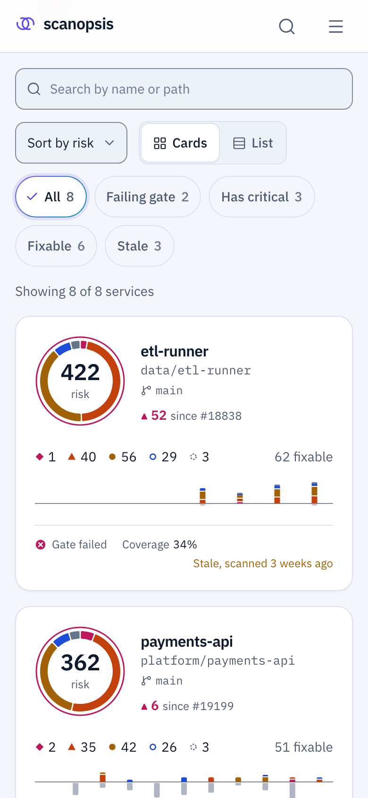

<div align="center">


# Scanopsis

**Code quality and container security for every service, in one view.**<br>
SonarQube and Trivy results from your GitLab CI/CD pipelines, side by side.

[](docs/versions.md)
[](go.mod)
[](web/package.json)
[](docs/deployment.md)
[](docs/getting-started.md)
[](LICENSE)

[Quick start](#quick-start) · [Documentation](#documentation) · [Screenshots](#screenshots) · [Report a problem](https://github.com/siyamsarker/scanopsis/issues)

</div>

---

Scanopsis is a small, self-hosted dashboard for teams that build software in
GitLab CI. Your pipelines already run **SonarQube** for code quality and
**Trivy** for vulnerabilities and leaked secrets. Scanopsis collects both
results as the pipelines run and shows them together, per service and across
all services, so you can answer "which services need attention?" in seconds
instead of clicking through job logs and SonarQube projects.


> **Status:** install **0.4.1**, the newest version (branch `release/0.4.1`,
> tag `v0.4.1`). It is an early version: every feature below works and is
> tested end to end, but the accuracy check against real pipeline data is
> still open. Deploy the version branch, never `main`, which is development
> code.

**Contents:** [Why Scanopsis](#why-scanopsis) · [Principles](#principles) ·
[Use cases](#use-cases) · [How it works](#how-it-works) · [Features](#features) ·
[Screenshots](#screenshots) · [How it compares](#how-it-compares) ·
[Requirements](#requirements) · [Quick start](#quick-start) ·
[Documentation](#documentation) · [Versions and upgrading](#versions-and-upgrading) ·
[Security](#security) · [Contributing](#contributing) · [Licence and author](#licence-and-author)

---

## Why Scanopsis

Each scanner is good at its job, but the results end up in different places.
Trivy writes a report per pipeline job. SonarQube keeps its results in its own
interface, one project at a time. Simple questions turn into a hunt:

- Which of our services is in the worst shape right now?
- Where do we still ship this CVE?
- Did the last release fix anything, or add new problems?
- Is test coverage going up or down?

Scanopsis keeps both results for every pipeline, links them to the service
they belong to, and puts the answers on one page. It is meant for platform,
security and development teams that want one clear overview without
installing and running a large platform.

## Principles

- **One view.** Code quality and container security of every service on one
  dashboard, from the pipelines you already run.
- **Every number is traceable.** Each figure links back to the pipeline, job
  and commit that produced it.
- **No shared secrets.** CI jobs prove who they are with GitLab CI/CD ID
  tokens; there is no upload key to store, leak or rotate.
- **Small and self-hosted.** One Go binary with the web interface built in,
  plus PostgreSQL. Nothing leaves your network except the calls to your GitLab
  and SonarQube.
- **Secure by default.** Two-factor authentication for every user, secrets
  encrypted in the database, and an audit log of sign-ins and administrative
  changes.

## Use cases

- **Weekly health review.** A platform or engineering lead opens the portfolio
  and sees which services fail their quality gate, have critical
  vulnerabilities, or have not been scanned lately.
- **Responding to a new CVE.** A security engineer searches for the CVE and
  gets every affected service, branch and image, with the package version to
  upgrade to.
- **Before a release.** A developer checks the service dashboard: what is new
  since the previous scan, what was fixed, and which packages to upgrade
  first.
- **Tracking progress.** Trends per service show whether vulnerabilities and
  coverage move in the right direction over the last 30, 90 or 180 days.
- **Audit and compliance.** The audit log records sign-ins, setting changes,
  user changes and rejected uploads, and the original Trivy report of a
  current scan can be exported to check any number against Trivy itself.

## How it works



1. A job in your GitLab pipeline runs Trivy and uploads the JSON report to
   Scanopsis. The job proves who it is with a GitLab CI/CD **ID token** (a
   short-lived signed token that GitLab gives each job).
2. SonarQube sends a signed webhook after each analysis. Scanopsis then reads
   the quality gate, ratings and coverage through the SonarQube Web API, and
   syncs regularly in case a webhook was missed.
3. Scanopsis stores everything in PostgreSQL and shows it in the browser.

## Features

| Feature | What you get |
| :--- | :--- |
| **Portfolio** | All services ranked by risk, as cards or a compact list: the risk of the whole portfolio and its last week, what needs attention, and per service the open findings, quality gate, coverage, how fresh the data is and how the last pipelines moved it. |
| **Service dashboard** | One sentence on where the service stands, then what every pipeline added and fixed, with its quality gate and coverage, on one branch or all of them. A "fix first" list of the upgrades that clear the most risk and the exact version to move to, where the findings are, the quality gate with new code and overall code told apart, and the recent scans. |
| **Findings explorer** | Every vulnerability and secret finding of a service. Filter by severity, fix, package kind or text and see the risk of what is left; group by package, vulnerability or image; open a finding for its fix, a copyable upgrade command and the other services it affects. An upgrade plan lists the package upgrades that clear the most risk. |
| **Scan comparison** | What is new, fixed and unchanged in a scan, by severity, compared with the previous scan or any earlier scan of the same image. |
| **CVE search across services** | One summary of a vulnerability and every service and image that has it, by default on the dashboard branches and the protected branches and tags, or on every branch. |
| **Uploads without shared secrets** | GitLab CI/CD ID tokens authenticate each upload. You can limit uploads to certain GitLab groups and to protected branches and tags. |
| **SonarQube** | Quality gate, ratings, coverage and duplication, through signed webhooks and the Web API, in MQR and Standard mode. |
| **Sign-in** | GitLab (OpenID Connect) or local accounts, with mandatory two-factor authentication (an authenticator app plus recovery codes) for everyone. Two roles: admin and viewer. |
| **Administration** | A Settings page, secrets encrypted in the database, an audit log, user and session management, configurable data retention, and command-line tools to recover access. |
| **Backups and restore** | Back up everything from the admin panel, now or on a schedule, download and upload backups, and restore one in place or on a new host from the setup screen. Backups are signed, and a restore needs a typed confirmation and a two-factor code. |
| **Small and fast** | A container image of about 27 MB. It starts in well under a second and uses less than 10 MiB of memory when idle. |
| **Pleasant to use** | Dark and light themes with a switch, a command palette (Ctrl+K or Cmd+K) to jump to any service or page, keyboard shortcuts, and it works on phones. |

## Screenshots

<p>
  
  
</p>

The portfolio in the dark theme, and in the light theme on a phone. The
screenshot at the top shows a service dashboard.

## How it compares

Scanopsis does one narrow job: it shows SonarQube and Trivy results from
GitLab CI together. Other good tools cover parts of this, or much more.

| Tool | What it does | How Scanopsis relates |
| --- | --- | --- |
| [SonarQube](https://docs.sonarsource.com/sonarqube-community-build/) | Analyses source code: quality gate, issues, coverage, duplication, per project. It can import other tools' findings as external issues from SARIF files. | Scanopsis does not analyse code. It reads SonarQube's results and shows them next to the Trivy results of the same service. |
| [Trivy](https://trivy.dev/latest/docs/configuration/reporting/) | Scans images, file systems and more. Each run writes a report: a table, JSON, SARIF, a template, or an SBOM (a software bill of materials). | Scanopsis does not scan. It keeps the JSON report of every pipeline, so you get history, trends, scan comparison and search across services. |
| [GitLab security dashboards](https://docs.gitlab.com/user/application_security/security_dashboard/) | GitLab's container scanning uses Trivy and is in every tier. The [vulnerability report](https://docs.gitlab.com/user/application_security/vulnerability_report/) and the security dashboards are in GitLab Ultimate. | Scanopsis works with any GitLab tier: [ID tokens](https://docs.gitlab.com/ci/secrets/id_token_authentication/) are available in Free, Premium and Ultimate. If you have Ultimate, its built-in views may be all you need. |
| [DefectDojo](https://docs.defectdojo.com/) | A vulnerability management platform, with an open-source and a commercial Pro edition. It imports results from more than 500 security tools, including Trivy and SonarQube. | DefectDojo covers far more tools and workflows. Scanopsis is smaller and narrower: two tools, GitLab CI only, one binary and PostgreSQL. |
| [Dependency-Track](https://dependencytrack.org/) | An open-source OWASP platform for component analysis. It consumes CycloneDX SBOMs and analyses the components listed in them. | Dependency-Track works from SBOMs. Scanopsis reads Trivy's vulnerability and secret reports directly and adds SonarQube's code quality. |

Choose Scanopsis if you use GitLab CI, SonarQube and Trivy, and want a light,
self-hosted overview of both. Choose one of the others if you need many
scanners, a full vulnerability management workflow, or SBOM-based tracking.

## Requirements

To run Scanopsis:

- A host with Docker Engine and the Compose plugin. The
  [deployment guide](docs/deployment.md) also covers plain `docker run`,
  Podman and Kubernetes.
- PostgreSQL. The Compose file brings PostgreSQL 18; an existing server works
  too.
- About 512 MiB of memory for the Scanopsis container (the Compose default).
- GitLab 15.7 or later, any tier, for the uploads. GitLab sign-in is optional.
- Trivy 0.50 or later on your CI runners.
- SonarQube, if you want code quality. The guide was written for SonarQube
  Community Build 26.9.

To build the image: Git, GNU Make and Docker. To develop: Go 1.27 and
Node.js 26 as well.

## Quick start

Scanopsis publishes no container image. You build it from the newest
**version branch**, `release/0.4.1`, never from `main`:

```sh
git clone --branch release/0.4.1 --depth 1 https://github.com/siyamsarker/scanopsis.git
cd scanopsis
make image IMAGE=scanopsis:v0.4.1
cd deploy/compose
```

Then:

1. Create the secret files in `secrets/` (database URL, database password,
   encryption key).
2. Create the data folders: `sudo install -d -m 700 -o 70 -g 70 data/postgres`
   for the database and `sudo install -d -m 700 -o 65532 -g 65532 backups`
   for the backups.
3. Copy `.env.example` to `.env` and set `SCANOPSIS_PUBLIC_URL`. It already
   runs the image you built, `scanopsis:v0.4.1`.
4. Run `docker compose up -d`.
5. Read the one-time setup token from the log and create the first
   administrator in the browser.

The [getting started guide](docs/getting-started.md) gives the exact commands
for each step, what you should see, and what to do when something fails. It
takes about 15 minutes. Then connect your pipelines with the
[GitLab CI guide](docs/integrations/gitlab-ci.md) and, if you use it,
[SonarQube](docs/integrations/sonarqube.md).

## Documentation

| Guide | What you find there | For whom |
| --- | --- | --- |
| [Getting started](docs/getting-started.md) | Build, start and set up Scanopsis step by step. | Operators |
| [Versions and upgrades](docs/versions.md) | Which version to deploy, and how to upgrade and roll back. | Everyone |
| [Configuration reference](docs/configuration.md) | Every setting and variable, defaults, validation, the secret key, rate limits. | Operators |
| [Deployment](docs/deployment.md) | Reverse proxy and TLS, existing PostgreSQL, other ways to run, sizing, upgrades. | Operators |
| [Operations](docs/operations.md) | Health checks, logs, administration commands, backup and restore, data retention. | Operators |
| [Troubleshooting](docs/troubleshooting.md) | Symptoms, causes and fixes. | Operators |
| [Upload Trivy reports from GitLab CI](docs/integrations/gitlab-ci.md) | The pipeline job, the upload script and its answers. | Operators, developers |
| [Connect SonarQube](docs/integrations/sonarqube.md) | The token, the webhook and linking projects. | Operators |
| [Sign in with GitLab](docs/integrations/gitlab-sso.md) | The GitLab application and allowed groups. | Operators |
| [Security model](docs/security.md) | Threat model, controls and a hardening checklist. | Operators, security reviewers |
| [Verifying the numbers](docs/verification.md) | How to check the dashboard against Trivy and SonarQube. | Everyone |
| [Architecture](docs/architecture.md) | Components, data flows and the data model. | Developers |
| [Development](docs/development.md) | Build, run and test Scanopsis from source. | Developers |
| [API reference](docs/api.md) | Every endpoint, generated from `api/openapi.yaml`. | Developers, integrators |
| [Contributing](CONTRIBUTING.md) | Checks, commits, sign-off and pull requests. | Developers |
| [Security policy](SECURITY.md) | How to report a vulnerability. | Everyone |
| [Code of conduct](CODE_OF_CONDUCT.md) | How we work together. | Everyone |

## Versions and upgrading

The newest version is **0.4.1**. Each version is a branch, such as
`release/0.4.1`, with a tag, such as `v0.4.1`, and never changes once
published. `main` is development code.

Already running Scanopsis? Upgrade to 0.4.1 from any older version in one
step: back up, move the database into a folder (the versions guide shows
how), build the 0.4.1 image and point `SCANOPSIS_IMAGE` at it. It updates
the database when it starts, if it has to (0.4.1 changes the database, so
back up first). The [versions guide](docs/versions.md)
lists what to check for the version you run, and how to roll back.

The branches of older versions (0.1.0, 0.2.0, 0.3.0 and 0.4.0) stay on GitHub only as a
record. They receive no fixes, so do not install them.

## Security

Please report security problems privately, as the
[security policy](SECURITY.md) explains. Only the newest version receives
fixes.

## Contributing

Contributions are welcome. Read [CONTRIBUTING.md](CONTRIBUTING.md) for the
checks to run, the commit style and the sign-off, and the
[development guide](docs/development.md) to get started with the code.

## Licence and author

Copyright 2026 Siyam Sarker. Licensed under the [Apache License 2.0](LICENSE).

Author and maintainer: Siyam Sarker ([github.com/siyamsarker](https://github.com/siyamsarker), [siyam.ts@gmail.com](mailto:siyam.ts@gmail.com)).

Scanopsis works with SonarQube, Trivy and GitLab. It is not affiliated with or
endorsed by SonarSource, Aqua Security or GitLab.
