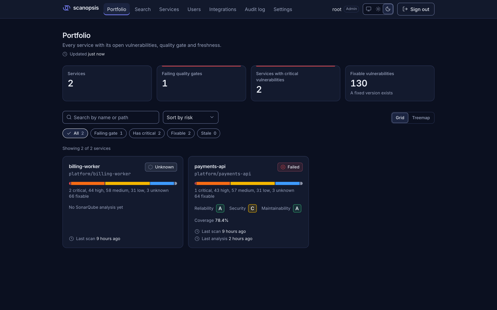

# Scanopsis

A small, self-hosted dashboard that shows SonarQube and Trivy results from your GitLab CI/CD pipelines in one view.

[](LICENSE)


> **Status:** the newest version is **0.2.0** (branch `release/0.2.0`, tag
> `v0.2.0`). It is an early version: every feature below works and is tested
> end to end, but the accuracy check against real pipeline data is still
> open. Deploy a version branch, never `main`, which is development code.

## Why Scanopsis

Many teams run two scanners in GitLab CI: **SonarQube** for code quality and
**Trivy** for vulnerabilities in container images and for leaked secrets. Each
tool is good at its job, but the results end up in different places. Trivy
writes a report per pipeline job. SonarQube keeps its results in its own
interface, one project at a time. To answer a simple question, such as "which
of our services is in bad shape?" or "where do we still ship this CVE?", you
click through pipelines, job logs and SonarQube projects.

Scanopsis collects both results as your pipelines run and puts them side by
side, per service and across all services. It is meant for a platform,
security or development team that wants one clear overview, without a large
platform to install and run.

## How it works

1. A job in your GitLab pipeline runs Trivy and uploads the JSON report to
   Scanopsis. The job proves who it is with a GitLab CI/CD **ID token** (a
   short-lived signed token that GitLab gives each job), so there is no shared
   secret to store or rotate.
2. SonarQube sends a signed webhook after each analysis. Scanopsis then reads
   the quality gate, ratings and coverage through the SonarQube Web API, and
   syncs regularly in case a webhook was missed.
3. Scanopsis stores everything in PostgreSQL and shows it in the browser.
   Every number is traceable to the pipeline, job and commit that produced
   it.

It is one Go binary with the web interface built in, plus PostgreSQL. You run
it on your own host; nothing leaves your network except the calls to your
GitLab and SonarQube.

## Features

- **Portfolio.** All services at a glance, as a grid or a treemap: open
  vulnerabilities, quality gate and how fresh the data is.
- **Service dashboard.** Trivy and SonarQube results for the branch an
  administrator chooses, with trends across pipelines, the recent scans, and
  a "fix first" list: the packages with the most findings and the version to
  upgrade to.
- **Findings explorer.** Every vulnerability and secret finding of a service.
- **Scan comparison.** What is new and what was fixed since the previous scan.
- **CVE search across services.** By default on the dashboard branches and
  the protected branches and tags, or on every branch.
- **Uploads without shared secrets.** GitLab CI/CD ID tokens authenticate each
  upload. You can limit uploads to certain GitLab groups and to protected
  branches and tags.
- **SonarQube.** Quality gate, ratings, coverage and duplication, through
  signed webhooks and the Web API, in MQR and Standard mode.
- **Sign-in.** With GitLab (OpenID Connect) or local accounts, with mandatory
  two-factor authentication (an authenticator app plus recovery codes) for
  everyone. Two roles: admin and viewer.
- **Administration.** A Settings page, secrets encrypted in the database, an
  audit log, user and session management, configurable data retention, and
  command-line tools to recover access.
- **Small and fast.** A container image of about 27 MB. It starts in well
  under a second and uses less than 10 MiB of memory when idle.
- **Pleasant to use.** Dark and light themes with a switch, and it works on
  phones.

## Screenshots

<p>
  
  
</p>

The portfolio in the dark theme, and in the light theme on a phone. The
screenshot at the top shows a service dashboard.

## How it compares

Scanopsis does one narrow job: it shows SonarQube and Trivy results from
GitLab CI together. Other good tools cover parts of this, or much more.

| Tool | What it does | How Scanopsis relates |
| --- | --- | --- |
| [SonarQube](https://docs.sonarsource.com/sonarqube-community-build/) | Analyses source code: quality gate, issues, coverage, duplication, per project. It can import other tools' findings as external issues from SARIF files. | Scanopsis does not analyse code. It reads SonarQube's results and shows them next to the Trivy results of the same service. |
| [Trivy](https://trivy.dev/latest/docs/configuration/reporting/) | Scans images, file systems and more. Each run writes a report: a table, JSON, SARIF, a template, or an SBOM (a software bill of materials). | Scanopsis does not scan. It keeps the JSON report of every pipeline, so you get history, trends, scan comparison and search across services. |
| [GitLab security dashboards](https://docs.gitlab.com/user/application_security/security_dashboard/) | GitLab's container scanning uses Trivy and is in every tier. The [vulnerability report](https://docs.gitlab.com/user/application_security/vulnerability_report/) and the security dashboards are in GitLab Ultimate. | Scanopsis works with any GitLab tier: [ID tokens](https://docs.gitlab.com/ci/secrets/id_token_authentication/) are available in Free, Premium and Ultimate. If you have Ultimate, its built-in views may be all you need. |
| [DefectDojo](https://docs.defectdojo.com/) | A vulnerability management platform, with an open-source and a commercial Pro edition. It imports results from more than 500 security tools, including Trivy and SonarQube. | DefectDojo covers far more tools and workflows. Scanopsis is smaller and narrower: two tools, GitLab CI only, one binary and PostgreSQL. |
| [Dependency-Track](https://dependencytrack.org/) | An open-source OWASP platform for component analysis. It consumes CycloneDX SBOMs and analyses the components listed in them. | Dependency-Track works from SBOMs. Scanopsis reads Trivy's vulnerability and secret reports directly and adds SonarQube's code quality. |

Choose Scanopsis if you use GitLab CI, SonarQube and Trivy, and want a light,
self-hosted overview of both. Choose one of the others if you need many
scanners, a full vulnerability management workflow, or SBOM-based tracking.

## Requirements

To run Scanopsis:

- A host with Docker Engine and the Compose plugin. The
  [deployment guide](docs/deployment.md) also covers plain `docker run`,
  Podman and Kubernetes.
- PostgreSQL. The Compose file brings PostgreSQL 18; an existing server works
  too.
- About 512 MiB of memory for the Scanopsis container (the Compose default).
- GitLab 15.7 or later, any tier, for the uploads. GitLab sign-in is optional.
- Trivy 0.50 or later on your CI runners.
- SonarQube, if you want code quality. The guide was written for SonarQube
  Community Build 26.9.

To build the image: Git, GNU Make and Docker. To develop: Go 1.27 and
Node.js 26 as well.

## Quick start

Scanopsis publishes no container image. You build it from a **version
branch** (`release/X.Y.Z`), never from `main`. Here with the newest version,
0.2.0:

```sh
git clone --branch release/0.2.0 --depth 1 https://github.com/siyamsarker/scanopsis.git
cd scanopsis
make image IMAGE=scanopsis:v0.2.0
cd deploy/compose
```

Then:

1. Create the secret files in `secrets/` (database URL, database password,
   encryption key).
2. Copy `.env.example` to `.env` and set `SCANOPSIS_PUBLIC_URL` and
   `SCANOPSIS_IMAGE=scanopsis:v0.2.0`.
3. Run `docker compose up -d`.
4. Read the one-time setup token from the log and create the first
   administrator in the browser.

The [getting started guide](docs/getting-started.md) gives the exact commands
for each step, what you should see, and what to do when something fails. It
takes about 15 minutes.

## Documentation

| Guide | What you find there | For whom |
| --- | --- | --- |
| [Getting started](docs/getting-started.md) | Build, start and set up Scanopsis step by step. | Operators |
| [Versions and upgrades](docs/versions.md) | Which version to deploy, how to upgrade and roll back, and the version history. | Everyone |
| [Configuration reference](docs/configuration.md) | Every setting and variable, defaults, validation, the secret key, rate limits. | Operators |
| [Deployment](docs/deployment.md) | Reverse proxy and TLS, existing PostgreSQL, other ways to run, sizing, upgrades. | Operators |
| [Operations](docs/operations.md) | Health checks, logs, administration commands, backup and restore, data retention. | Operators |
| [Troubleshooting](docs/troubleshooting.md) | Symptoms, causes and fixes. | Operators |
| [Upload Trivy reports from GitLab CI](docs/integrations/gitlab-ci.md) | The pipeline job, the upload script and its answers. | Operators, developers |
| [Connect SonarQube](docs/integrations/sonarqube.md) | The token, the webhook and linking projects. | Operators |
| [Sign in with GitLab](docs/integrations/gitlab-sso.md) | The GitLab application and allowed groups. | Operators |
| [Security model](docs/security.md) | Threat model, controls and a hardening checklist. | Operators, security reviewers |
| [Verifying the numbers](docs/verification.md) | How to check the dashboard against Trivy and SonarQube. | Everyone |
| [Architecture](docs/architecture.md) | Components, data flows and the data model. | Developers |
| [Development](docs/development.md) | Build, run and test Scanopsis from source. | Developers |
| [API reference](docs/api.md) | Every endpoint, generated from `api/openapi.yaml`. | Developers, integrators |
| [Contributing](CONTRIBUTING.md) | Checks, commits, sign-off and pull requests. | Developers |
| [Security policy](SECURITY.md) | How to report a vulnerability. | Everyone |
| [Code of conduct](CODE_OF_CONDUCT.md) | How we work together. | Everyone |

## Versions and upgrading

Each version is a branch `release/X.Y.Z` with a tag `vX.Y.Z`, and never
changes once published. `main` is development code. To upgrade, back up,
build the new version's image and point `SCANOPSIS_IMAGE` at it. The new
version updates the database when it starts. The
[versions guide](docs/versions.md) has the steps, how to roll back, and what
changed in each version.

## Security

Please report security problems privately, as the
[security policy](SECURITY.md) explains. Only the newest version receives
fixes.

## Contributing

Contributions are welcome. Read [CONTRIBUTING.md](CONTRIBUTING.md) for the
checks to run, the commit style and the sign-off, and the
[development guide](docs/development.md) to get started with the code.

## Licence and author

Copyright 2026 Siyam Sarker. Licensed under the [Apache License 2.0](LICENSE).

Author and maintainer: Siyam Sarker ([github.com/siyamsarker](https://github.com/siyamsarker), [siyam.ts@gmail.com](mailto:siyam.ts@gmail.com)).

Scanopsis works with SonarQube, Trivy and GitLab. It is not affiliated with or
endorsed by SonarSource, Aqua Security or GitLab.
