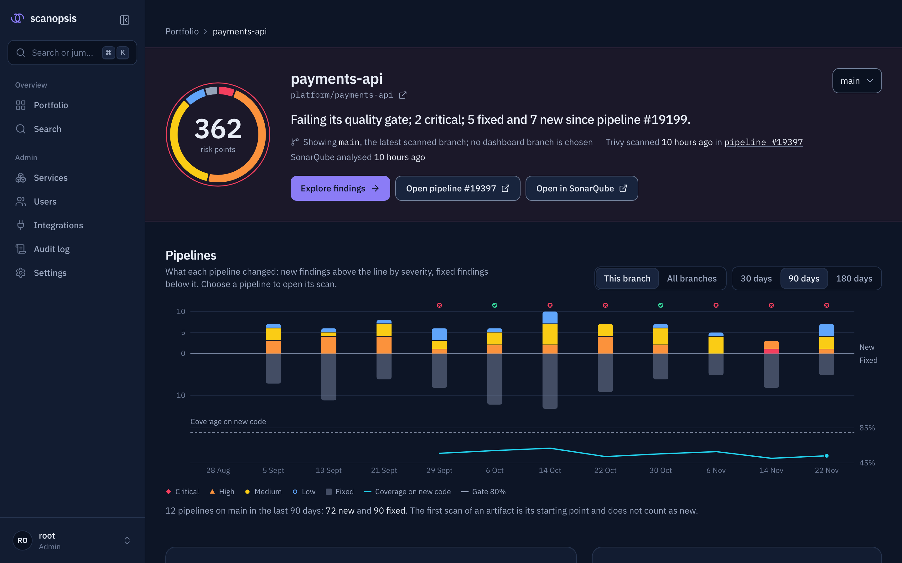

# Scanopsis

Scanopsis is a small, self-hosted dashboard that shows SonarQube and Trivy
results from your GitLab CI/CD pipelines in one view.

> **Status:** the newest version, 0.2.0, is published as the branch
> `release/0.2.0`. It is an early version: all features below work and are
> tested end to end, but the accuracy check with real pipeline data is still
> open. Deploy a version branch (`release/X.Y.Z`), never `main`, which is
> development code. See [versions and branches](docs/versions.md).



## Features

- **One view of both tools.** A portfolio of all services with open
  vulnerabilities, quality gate and freshness; a dashboard per service, for
  the branch an administrator chooses, with trends across pipelines; a findings explorer with a "fix first" list of
  packages; and a CVE search across services (by default on the dashboard branches and the protected refs, optionally on every branch).
- **Trivy uploads without shared secrets.** GitLab CI jobs upload image and
  secret scan reports, authenticated with GitLab CI/CD ID tokens. You can limit
  uploads to namespaces and to protected branches and tags.
- **SonarQube.** Quality gate, ratings, coverage and duplication, received
  through signed webhooks and the SonarQube Web API, with a periodic sync.
- **Sign-in.** GitLab (OpenID Connect) and local accounts, with mandatory
  two-factor authentication (TOTP and recovery codes) for everyone. First-run
  setup is protected by a one-time token, and an admin command recovers access.
- **Operations.** Settings seeded from the environment and editable later on a
  settings page, secrets encrypted in the database, an audit log and a
  configurable retention period.
- **Small footprint.** One container image under 30 MB plus PostgreSQL. It starts
  in well under a second and uses about 10 MiB of memory when idle.

Every number on the dashboard is traceable to the pipeline, job and commit
that produced it. The interface has a dark and a light theme and works on
phones.

<p>
  
  
</p>

Scanopsis works with SonarQube and Trivy. It is not affiliated with or endorsed
by SonarSource, Aqua Security or GitLab.

## Quick start

Scanopsis publishes no container image. You clone a version branch, build the
image, and then start Scanopsis and PostgreSQL with Docker Compose. Replace
`X.Y.Z` with a version from [versions and branches](docs/versions.md):

```sh
git clone --branch release/X.Y.Z --depth 1 https://github.com/siyamsarker/scanopsis.git
cd scanopsis
make image IMAGE=scanopsis:vX.Y.Z
cd deploy/compose
```

Replace `X.Y.Z` with the newest version, for example `0.2.0`. See
[find the newest version](docs/versions.md#find-the-newest-version).

Then create the secrets and the configuration file (set
`SCANOPSIS_IMAGE=scanopsis:vX.Y.Z` in `.env`), run `docker compose up -d` and
finish the setup in the browser. The
[getting started guide](docs/getting-started.md) explains each step, how to
check it and what to do when it fails.

## Build from source

You need Go 1.27, Node.js 26 LTS, GNU Make and a PostgreSQL database. The
[development guide](docs/development.md) shows how to build the binary, start
a database, run the server and run the checks.

## Documentation

For operators:

- [Getting started](docs/getting-started.md)
- [Versions and branches](docs/versions.md): which branch to deploy, how to
  upgrade and roll back
- [Configuration reference](docs/configuration.md)
- [Sign in with GitLab](docs/integrations/gitlab-sso.md)
- [Upload Trivy reports from GitLab CI](docs/integrations/gitlab-ci.md)
- [Connect SonarQube](docs/integrations/sonarqube.md)
- [Operations](docs/operations.md): health checks, logs, administration
  commands, recovering access, backup and restore
- [Docker Compose files](deploy/compose/README.md)
- [Deployment](docs/deployment.md): reverse proxy and TLS, internal certificate
  authority, sizing, upgrades and rollback
- [Troubleshooting](docs/troubleshooting.md): symptoms, causes and fixes
- [Architecture](docs/architecture.md): components, data flows, data model
- [Security](docs/security.md): threat model, controls, hardening checklist
- [Verifying the numbers](docs/verification.md): the accuracy check against
  Trivy and SonarQube
- [API reference](docs/api.md): generated from the OpenAPI document

For contributors and project policy:

- [Development guide](docs/development.md)
- [Contributing](CONTRIBUTING.md)
- [Security policy](SECURITY.md)
- [Code of conduct](CODE_OF_CONDUCT.md)
- [Changelog](CHANGELOG.md)

## Licence

Scanopsis is licensed under the [Apache License 2.0](LICENSE).
