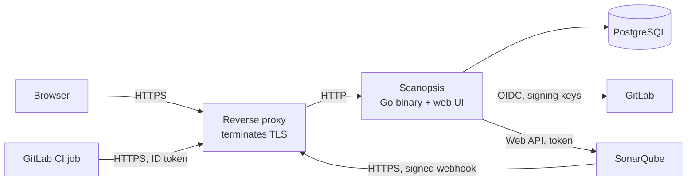
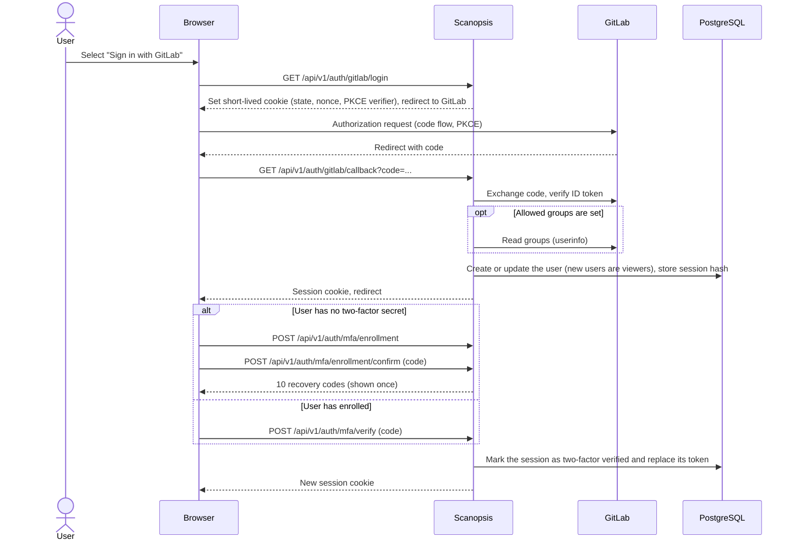
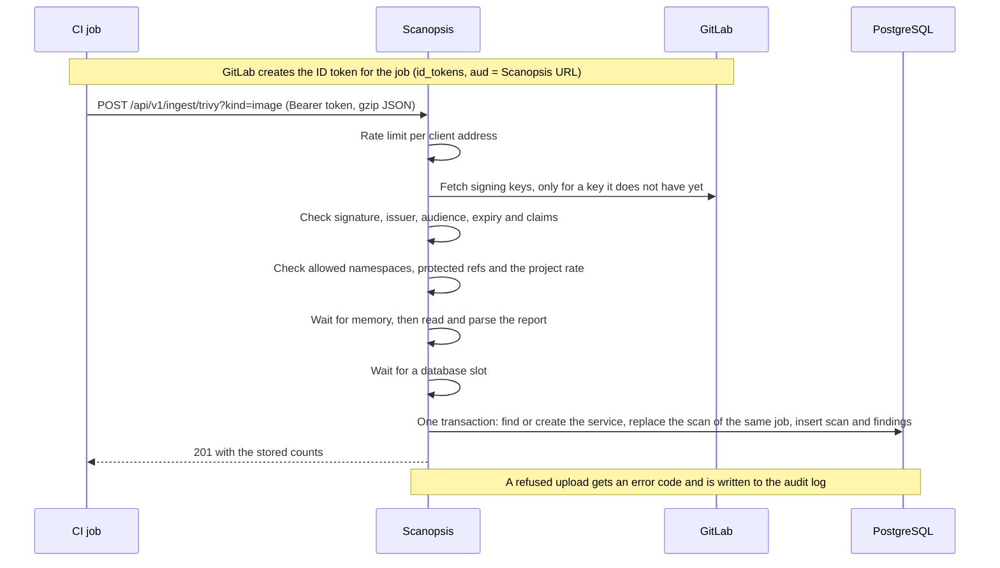
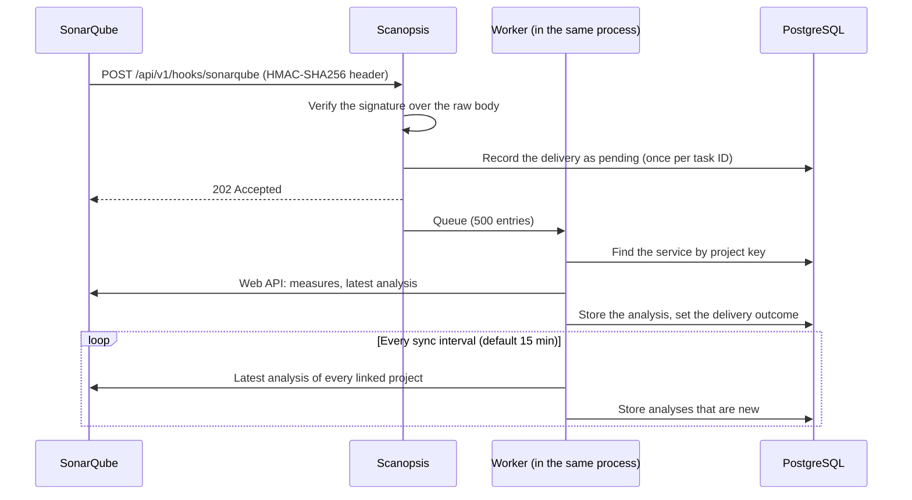
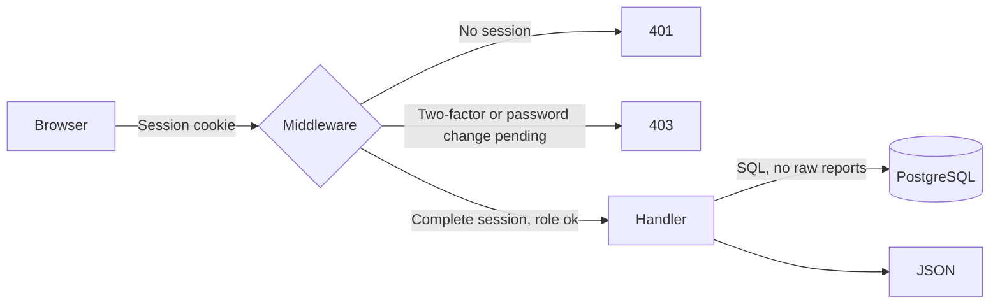

# How Scanopsis works

See what runs where, how data moves through Scanopsis, and why it is built this
way. Read it before you change the code, or when you need to explain the design
to someone.

**Audience:** Developers · **Back to:** [README](../README.md) · [All guides](../README.md#documentation)

---

The diagrams use [Mermaid](https://mermaid.js.org/), which GitHub draws as
pictures. In a plain text viewer, read each one as a list of steps.

## The parts

Scanopsis has two parts that run:

| Part | What it is | What it keeps |
| --- | --- | --- |
| Scanopsis | One Go binary. It serves the JSON API, the web interface (embedded in the binary) and the health probes, and it runs the background jobs. | Nothing on disk. Everything is in PostgreSQL, except a few things in memory, see [Run one server per database](#run-one-server-per-database). |
| PostgreSQL | The only datastore: users, sessions, settings, services, scans, findings, SonarQube analyses and the audit log. | Everything. Back it up. |

The binary has two more modes: `scanopsis admin ...` for account recovery and
report export (see [operations](operations.md)), and `scanopsis healthcheck`,
which the container health check runs.

Scanopsis talks to three outside systems:

| System | Direction | Why |
| --- | --- | --- |
| GitLab | Scanopsis calls GitLab | To sign users in with OpenID Connect, to read a user's groups, and to download the public keys that check CI ID tokens. |
| GitLab CI jobs | Jobs call Scanopsis | To upload Trivy reports. |
| SonarQube | Both ways | SonarQube calls the webhook after an analysis. Scanopsis calls the SonarQube Web API to read the results. |

Scanopsis never calls the GitLab API with a stored access token, see [Key design
decisions](#key-design-decisions).

## How data moves

### Sign-in with GitLab, then a two-factor code

Every user passes two factors, local and GitLab users alike. A session starts
after the first factor, but it cannot use the application until the second
factor is checked. When the second factor passes, the session gets a new token,
so a token captured before is useless.

Local sign-in replaces the first half with `POST /api/v1/auth/local/login`: a
username and a password, checked against an Argon2id hash. Then it goes on the
same way. The first administrator is created once, on the setup page, with a
one-time token from the server log. See the [getting started
guide](getting-started.md).

### Upload from CI with an ID token

The project, pipeline, job, branch and commit come from the checked token, never
from the report. Uploading the same job, artifact and kind again replaces the
earlier scan, so a retried job never duplicates data. Uploads of one GitLab
project take a database advisory lock, one at a time, so two first uploads
create one service, not two.

Uploads are admitted by the memory they need, which grows with their size, so
many small reports run at once and large ones fewer at a time. At most a quarter
of the database connections store uploads at the same time. [Upload Trivy
reports from GitLab CI](integrations/gitlab-ci.md) lists every limit.

### SonarQube: webhook, Web API and sync

The webhook answers at once and does the work afterwards, because SonarQube
waits only 10 seconds. The sync every interval is the safety net for deliveries
that were lost, refused or interrupted. It runs under a database advisory lock,
so only one server syncs at a time.

### Reading the dashboards

Reads never load the stored original report. Only `scanopsis admin
export-report` does, on request. The portfolio and the service pages are
computed in SQL from the counts kept on each scan row and from the latest
SonarQube analysis. See [What "current" means](#what-current-means).

## Trust boundaries

| Boundary | Who is on each side | What crosses it | What protects it |
| --- | --- | --- | --- |
| Network to the reverse proxy | Anyone, and the proxy | HTTPS requests | TLS at the proxy. |
| Proxy to Scanopsis | The proxy, and Scanopsis | HTTP requests with `X-Forwarded-For` | The proxy runs next to Scanopsis. `SCANOPSIS_TRUSTED_PROXIES` names the only addresses whose forwarded header is believed. |
| Browser to the API | Users, and Scanopsis | Session cookie, JSON | Session and role checks, a cross-origin check, security headers. |
| CI job to the upload endpoint | A job in your GitLab, and Scanopsis | A signed ID token and a report | Signature check against your GitLab's keys, audience, namespace and protected-ref rules. The report is treated as untrusted data. |
| SonarQube to the webhook | SonarQube, and Scanopsis | A signed JSON body | HMAC signature with a shared secret. The body only names a project and a task: the values are read from SonarQube afterwards. |
| Scanopsis to GitLab and SonarQube | Scanopsis, and those servers | Requests, with a bearer token for SonarQube | Certificate checks that cannot be turned off. No redirects to another scheme or host for SonarQube calls. |
| Scanopsis to PostgreSQL | Scanopsis, and the database | SQL | A private network. Secrets are encrypted before they are stored. |

[Security](security.md) lists the controls on each boundary and the risks that
remain.

## Data model

Migrations in `internal/store/migrations` create and update the schema when the
server starts. The tables:

| Table | What it holds |
| --- | --- |
| `users` | One row per person. `source` is `local` or `gitlab`. Local users have an Argon2id `password_hash`. GitLab users have a `gitlab_user_id` and the `gitlab_issuer` (the GitLab URL); the pair is unique. `role` is `admin` or `viewer`. `disabled_at` is set while the account is disabled. Two-factor state: the encrypted secret, when it was enabled, the last accepted time step, the count of wrong codes in a row (ten lock the second factor), and a flag that forces a password change after a reset. |
| `sessions` | One row per sign-in. The key is the SHA-256 of the session token, never the token. Also a stable number shown in the session list, the user, the creation, last-seen and expiry times, whether the second factor passed, and the client address and User-Agent (first 200 bytes) at sign-in. |
| `recovery_codes` | The stored form of each recovery code: an HMAC keyed from the secret key, or the SHA-256 of a code issued by version 0.1.0. Also its version and when it was used. |
| `settings` | The runtime settings. Plain values are JSON, secret values are encrypted. Each row records whether the value came from the environment or the Settings page, who changed it and when. |
| `audit_log` | Security events: actor, action and a JSON detail. |
| `services` | One service per GitLab project: name, GitLab project ID and path, the optional SonarQube project key, how it was created (`ingest` or `manual`), and whether it is archived. |
| `scans` | One Trivy report for one artifact in one CI job: pipeline, job, ref, whether the ref was protected, commit, the time Trivy ran (`scanned_at`), the time Scanopsis received it, the counts per severity and of fixable, secret and suppressed findings, and the report as uploaded, gzip-compressed (`raw_report`). A job, artifact and kind exist once per service. |
| `vulnerabilities` | The vulnerabilities of a scan: target, class, package, installed and fixed version, ID, severity, status, title, link, and whether and why Trivy suppressed it. |
| `secret_findings` | The secret findings of a scan: target, rule, category, severity and line numbers. The matched text is never stored. |
| `sonar_analyses` | One SonarQube analysis of a linked service: the quality gate and its conditions, every measure as reported, the mode (`mqr` or `standard`), the normalised ratings, coverage and duplication (empty when not reported). |
| `sonar_deliveries` | Every webhook delivery, linked or not, with its outcome (`pending`, `linked`, `unlinked`, `failed`), a detail text and the number of attempts. It feeds the Integrations page. |

Deleting a service deletes its scans, findings and analyses (`ON DELETE
CASCADE`). Deleting a scan deletes its findings.

## Background jobs

All jobs run inside the Scanopsis process. There is no separate worker.

| Job | When | What it does |
| --- | --- | --- |
| Session clean-up | Every hour | Deletes sessions past their absolute or idle expiry. |
| SonarQube workers | All the time | Four workers process queued webhook deliveries. Up to 500 wait. A delivery that finds the queue full stays pending for the next sync. |
| SonarQube sync | Every sync interval (default 15 minutes, at least 1 minute), checked every 10 seconds | Reads the newest analysis of every linked project. Marks deliveries pending for more than 10 minutes as interrupted. Stops early when SonarQube does not answer. Holds an advisory lock on a connection of its own, and no pooled connection while it calls SonarQube. |
| Retention | One minute after start, then every 24 hours | Deletes scans, SonarQube analyses and deliveries older than the retention period (default 90 days), but keeps the current scans and the latest analysis of every service. Empties the stored original report of a scan that is not current after 30 days. Deletes audit events after 365 days, or after the retention period if that is longer. A run that deletes anything writes an audit event. See [operations](operations.md). |

## What "current" means

The dashboards show the current state of a service. The definition is exact:

- **Which ref.** One rule decides the ref a dashboard shows. A `ref` you select
  on the page, or pass to the API, wins. Otherwise the **dashboard branch** an
  administrator chose for the service is used, even when it has no scans yet:
  the dashboards then say, for example, "No scans of main yet" and do not fall
  back to another branch. When no dashboard branch is chosen, the ref of the
  most recent scan is used, so a scan of any branch can change what is shown.
  The API reports which case applied as `ref_source`: `requested`, `default` or
  `latest`.
- **Which scans.** For that ref, the current state is the **latest scan per
  artifact and kind**. "Latest" means the newest `scanned_at`, the time in the
  Trivy report (`CreatedAt`), then the highest scan ID. It is not the time the
  report arrived. If the report time is in the future, Scanopsis uses its own
  clock instead, so a wrong clock cannot keep a scan current forever.
- **Which numbers.** The numbers on the portfolio and the service page are the
  sums of the counts of those latest scans. Only unsuppressed findings count.

So a report uploaded late does not replace newer results, and a retried job
replaces only itself.

The queries behind these numbers read indexes, not whole tables. They stay fast
with 500 services and 90 days of history, which is about 540,000 scans and
millions of findings:

- The portfolio finds the latest scan per artifact by jumping from one artifact
  to the next in a covering index on `scans` that also holds the counts, so it
  never reads the table. A second index finds the ref with the most recent scan
  of a service.
- "First seen" looks for the same finding in the earlier scans of an artifact,
  through an index on the scan and a hash of the vulnerability ID, package and
  target. The hash is needed because those fields can be 4,096 bytes long, more
  than an index entry holds. The query then compares the real values.
- The vulnerability search reads the current scans in its scope once, through an
  index on the lower-case vulnerability ID and the scan. By default the scope
  is, for each service, the ref its dashboards show and every protected ref. A
  partial index on the scans of protected refs finds those without visiting
  every branch. `scope=all` searches every ref. The search lists at most 1,000
  findings, the most severe first, and reports the true totals with a
  `truncated` flag. A scan diff lists at most 500 new and 500 fixed findings and
  reports the full counts the same way.
- A service overview reads all its numbers in one read-only transaction, so they
  all come from the same moment.

## Key design decisions

| Decision | Why |
| --- | --- |
| **No GitLab API token.** Scanopsis stores no personal or project access token for GitLab. Its only GitLab credential is the secret of the sign-in application, encrypted. | A stored token is a credential to protect, rotate and scope. Scanopsis needs only three things from GitLab: sign-in (users sign in themselves), group membership (read with the user's own token during sign-in), and the signing keys (public). |
| **GitLab CI ID tokens for uploads.** | GitLab creates and signs a short-lived token for each job. Scanopsis checks it against your GitLab's public keys. There is no shared upload secret to create, store or leak, and the token proves the project, pipeline, job, ref and commit. |
| **Current state follows the Trivy report time.** | The dashboards describe what Trivy found and when. Using the report time makes the result independent of upload order and network delays. |
| **The original report is kept compressed, for a while.** | It lets you check any number against what Trivy wrote: `scanopsis admin export-report` writes it out for `trivy convert`. No page or API reads it. It is also most of the database and of every backup, so retention empties it 30 days after the scan, unless the scan is current. A cleared report cannot be exported. |
| **Settings start from the environment, then live in the database.** | A new deployment can start from a file. Afterwards administrators change settings without a restart, and an old environment file cannot quietly undo their changes. See [configuration](configuration.md). |
| **Two-factor authentication for everyone.** | Scanopsis shows vulnerability data for every service, so every account, GitLab accounts too, enrols an authenticator app (TOTP). |
| **One binary and one database.** | The load is small: a few thousand uploads a day. Fewer parts means less to run, secure and upgrade. |
| **Secrets encrypted with one key from the environment.** | The database holds two-factor secrets and the credentials entered on the Settings page. A backup is useless without the key. See [configuration](configuration.md). |

### Run one server per database

The design supports one Scanopsis server per database, not more:

- Rate limits and the setup token live in memory, so each server would have its
  own.
- The settings are read into memory at start and updated in the server that
  handled the change. Another server would not see the change until it restarts.
- The SonarQube sync and the retention job use database advisory locks, so a
  second server does not corrupt data. That is a safety net, not support.

For availability, rely on the container restart policy and on database backups.

---

[Back to the README](../README.md) · [All guides](../README.md#documentation) · Found a mistake? [Open an issue](https://github.com/siyamsarker/scanopsis/issues)
