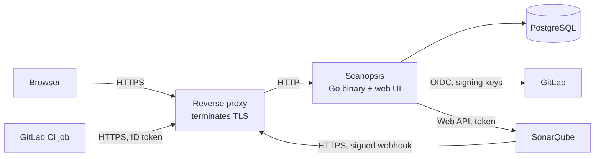
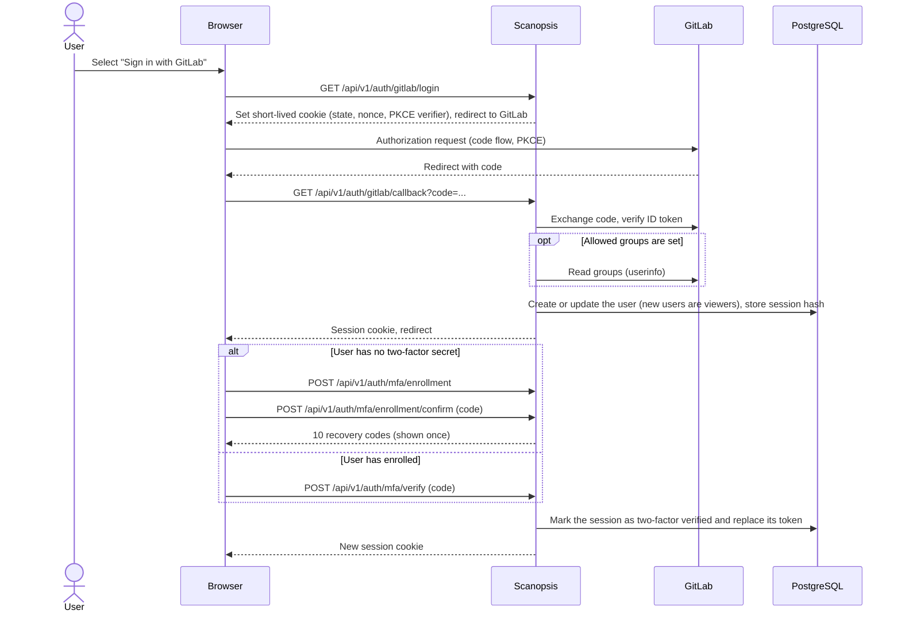
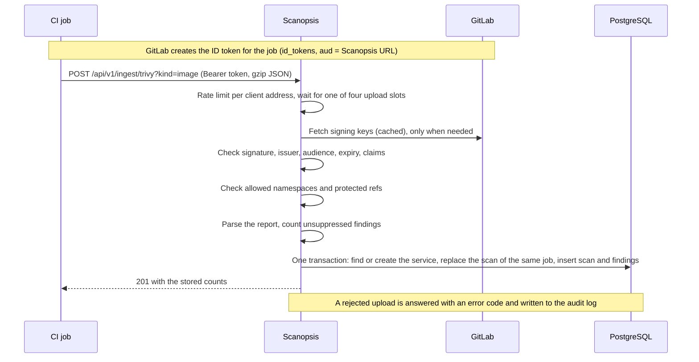
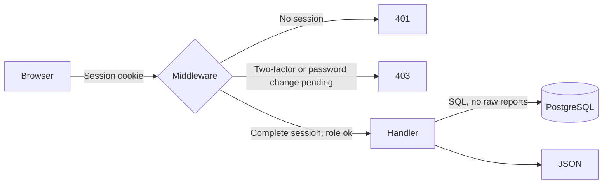

# Architecture

This page describes how Scanopsis is built and how data moves through it. Read
it to understand what runs where, what talks to what, and why. It does not
repeat setup steps. For those, see the [getting started guide](getting-started.md).

The diagrams use [Mermaid](https://mermaid.js.org/). GitHub renders them. In a
plain text viewer, read the code blocks as sequence lists.

## Components

Scanopsis has two runtime parts:

| Part | What it is | State |
|---|---|---|
| Scanopsis | One Go binary. It serves the JSON API, the web interface (embedded in the binary), the health probes, and runs the background jobs. | None on disk. Everything is in PostgreSQL, except a few in-memory items listed under [single instance](#single-instance). |
| PostgreSQL | The only datastore. It holds users, sessions, settings, services, scans, findings, SonarQube analyses and the audit log. | All of it. Back it up. |

The binary also contains two small command modes: `scanopsis admin ...` (user
recovery, see [operations](operations.md#administration-commands)) and
`scanopsis healthcheck` (used by the container health check).

Scanopsis talks to three outside systems:

| System | Direction | Why |
|---|---|---|
| GitLab | Scanopsis calls GitLab | To sign users in (OpenID Connect), to read the groups of a user, and to download the public signing keys that verify CI ID tokens. |
| GitLab CI jobs | Jobs call Scanopsis | To upload Trivy reports. |
| SonarQube | Both | SonarQube calls the webhook after an analysis. Scanopsis calls the SonarQube Web API to read the results. |

Scanopsis never calls the GitLab API with a stored access token. See
[key design decisions](#key-design-decisions).

## Data flows

### Sign-in with GitLab, then a two-factor code

Every user, local or GitLab, passes two factors. A session starts after the
first factor but cannot use the application until the second factor is
verified. When the second factor passes, the session gets a new token, so a
token captured earlier is useless.

Local sign-in replaces the first half with `POST /api/v1/auth/local/login`
(username and password, checked against an Argon2id hash) and then continues
the same way. The first administrator is created once through the
[setup page](getting-started.md#step-6-get-the-setup-token), guarded by a
one-time token in the server log.

### Upload from CI with an ID token

The project, pipeline, job, branch and commit come from the verified token,
never from the report. A repeated upload for the same job, artifact and kind
replaces the earlier scan, so retrying a job never duplicates data. Uploads for
one GitLab project are serialised with a database advisory lock, so two first
uploads create one service.

### SonarQube: webhook, Web API and reconciliation

The webhook answers at once and does the work afterwards, because SonarQube
gives a webhook only 10 seconds. The periodic sync is the safety net for
deliveries that were lost, refused or interrupted. It runs under a database
advisory lock, so only one server does it at a time.

### Read path

Reads never load the stored raw report; only `scanopsis admin export-report`
does, on request. The portfolio and the service pages are
computed in SQL from the counts kept on each scan row and from the latest
SonarQube analysis. See [current state](#what-current-means).

## Trust boundaries

| Boundary | Who is on each side | What crosses it | What protects it |
|---|---|---|---|
| Internet or network to the reverse proxy | Anyone, and the proxy | HTTPS requests | TLS at the proxy. |
| Proxy to Scanopsis | The proxy, and Scanopsis | HTTP requests with `X-Forwarded-For` | The proxy runs next to Scanopsis. `SCANOPSIS_TRUSTED_PROXIES` names the only addresses whose forwarded header is believed. |
| Browser to the API | Users, and Scanopsis | Session cookie, JSON | Session checks, role checks, cross-origin check, security headers. |
| CI job to the upload endpoint | A job in your GitLab, and Scanopsis | A signed ID token and a report | Signature check against your GitLab's keys, audience, namespace and protected-ref rules. The report is untrusted data. |
| SonarQube to the webhook | SonarQube, and Scanopsis | A signed JSON body | HMAC signature with a shared secret. The body only names a project and a task. Values are read from SonarQube afterwards. |
| Scanopsis to GitLab and SonarQube | Scanopsis, and those servers | Requests with a bearer token (SonarQube) | Certificate verification (never disabled), no redirects to other hosts for SonarQube calls. |
| Scanopsis to PostgreSQL | Scanopsis, and the database | SQL | A private network. Secrets are encrypted before they are stored. |

[Security](security.md) lists the controls on each boundary and the risks that
remain.

## Data model

The schema is created and updated by migrations that run when the server
starts (`internal/store/migrations`). The tables:

| Table | What it holds |
|---|---|
| `users` | One row per person. `source` is `local` or `gitlab`. Local users have an Argon2id `password_hash`. GitLab users have a `gitlab_user_id`. `role` is `admin` or `viewer`. Two-factor state: the encrypted secret, when it was enabled, the last accepted time step, the number of wrong codes in a row (ten lock the second factor), and a flag that forces a password change after a reset. |
| `sessions` | One row per sign-in. The key is the SHA-256 of the session token, never the token. Holds the user, the creation, last-seen and expiry times, and whether the second factor was verified. |
| `recovery_codes` | The SHA-256 of each recovery code of a user and when it was used. |
| `settings` | The runtime settings. Plain values are JSON. Secret values are stored encrypted. Each row records whether the value came from the environment or from the Settings page, who changed it and when. |
| `audit_log` | Security events: actor, action and a JSON detail. |
| `services` | One service per GitLab project: name, GitLab project ID and path, optional SonarQube project key, how it was created (`ingest` or `manual`), and whether it is archived. |
| `scans` | One Trivy report for one artifact in one CI job. Holds the pipeline, job, ref, protection flag, commit, the time Trivy ran (`scanned_at`), the time Scanopsis received it, the counts per severity, fixable, secrets and suppressed findings, and the report as uploaded, gzip-compressed (`raw_report`, emptied by retention 30 days after the scan unless it is current). A job, artifact and kind exist once per service. |
| `vulnerabilities` | The vulnerabilities of a scan: target, class, package, installed and fixed version, ID, severity, status, title, link, and whether and why Trivy suppressed it. |
| `secret_findings` | The secret findings of a scan: target, rule, category, severity and line numbers. The matched text is never stored. |
| `sonar_analyses` | One SonarQube analysis of a linked service: the quality gate and its conditions, every measure as reported, the mode (`mqr` or `standard`), the normalised ratings, coverage and duplication (empty when not reported). |
| `sonar_deliveries` | Every webhook delivery, linked or not, with its outcome (`pending`, `linked`, `unlinked`, `failed`), a detail text and the number of attempts. It feeds the integration health page. |

Deleting a service deletes its scans, findings and analyses (`ON DELETE
CASCADE`). Deleting a scan deletes its findings.

## Background jobs

All jobs run inside the Scanopsis process. There is no separate worker.

| Job | When | What it does |
|---|---|---|
| Session clean-up | Every hour | Deletes sessions that passed their absolute or idle expiry. |
| SonarQube workers | Continuously | Four workers process queued webhook deliveries (up to 500 wait; a delivery that finds the queue full stays pending for the next sync). They run apart from the sync. |
| SonarQube sync | Every sync interval, checked every 10 seconds; default 15 minutes, minimum 1 minute | Reads the newest analysis of every linked project, marks deliveries that stayed pending for more than 10 minutes as interrupted, and stops early when SonarQube does not answer. Runs under an advisory lock held on its own connection; no pooled connection is held while SonarQube is called. |
| Retention | One minute after start, then every 24 hours | Deletes scan history older than the retention period, except the current scans (the latest scans of the dashboard branch, of protected refs and of the ref shown when no branch is chosen). Empties the stored original report of scans that are not current after 30 days. A run that deletes anything writes an audit event. See [data retention](operations.md#data-retention). |

## What "current" means

The dashboards show the current state of a service. The definition is exact:

- The ref a dashboard shows is decided by one rule. A `ref` you select on the
  page, or pass to the API, wins. Otherwise the **dashboard branch** that an
  administrator chose for the service is used, even when it has no scans yet
  (the dashboards then say "No scans of that branch yet" and do not show
  another branch). When no dashboard branch is chosen, the ref of the most
  recent scan is used, so a scan of any branch can change what is shown until
  an administrator chooses one. The API reports which case applied as
  `ref_source`: `requested`, `default` or `latest`.
- For a ref, the current state is the **latest scan per artifact and kind**.
  "Latest" is decided by `scanned_at`, which is the time in the Trivy report
  (`CreatedAt`), then by the scan ID. It is not the time the report arrived.
  If the report time is in the future, Scanopsis uses its own clock instead, so
  a wrong clock cannot keep a scan current forever.
- The numbers on the portfolio and on the service page are the sums of the
  counts of those latest scans. Only unsuppressed findings are counted.

The queries behind these numbers read indexes, not the whole tables, so they
stay fast with 500 services and 90 days of history (about 540,000 scans and
millions of findings):

- The portfolio finds the latest scan per artifact by jumping from one
  artifact to the next in a covering index on `scans` that also holds the
  counts, so it never reads the table. A second index finds the ref with the
  most recent scan of a service.
- "First seen" looks for the same finding in the earlier scans of an
  artifact through an index on the scan and a hash of the finding's
  vulnerability ID, package and target. A hash is used because those fields
  can be 4,096 bytes long, more than an index entry can hold; the query also
  compares the real values.
- The vulnerability search checks every current scan once, through an index
  on the lower-case vulnerability ID and the scan. It lists at most 1,000
  findings, the most severe first, and reports the true totals with a
  `truncated` flag. A scan diff lists at most 500 new and 500 fixed findings
  and reports the full counts the same way.
- A service overview reads all its numbers in one read-only transaction, so
  they come from the same moment.

Because of this, uploading an old report late does not replace newer results,
and a job that is retried replaces only itself.

## Key design decisions

| Decision | Reason |
|---|---|
| **No GitLab API token.** Scanopsis stores no personal or project access token for GitLab. The only GitLab credential it keeps is the secret of the sign-in application, encrypted. | A stored token is a credential to protect, rotate and scope. Scanopsis needs only three things from GitLab: sign-in (a user signs in themselves), group membership (read with that user's own token during sign-in), and signing keys (public). |
| **GitLab CI ID tokens for uploads.** | GitLab creates a short-lived token for each job and signs it. Scanopsis checks the signature against the public keys of your GitLab. There is no shared upload secret to create, store or leak, and the token proves the project, pipeline, job, ref and commit. |
| **Current state follows the Trivy report time.** | The dashboards describe what Trivy found and when. Using the report time makes the result independent of upload order and network delays. |
| **Raw report kept compressed, for a limited time.** | The compressed original lets you check any number against what Trivy wrote: `scanopsis admin export-report` writes it out for `trivy convert`. No page or API reads it, and it is most of the database and of every backup, so retention empties it 30 days after the scan unless the scan is current. A cleared report cannot be exported. |
| **Settings seeded from the environment, then owned by the database.** | A new deployment can start from a file. Afterwards administrators change settings without a restart, and an old environment file cannot silently undo their changes. See [configuration](configuration.md#two-kinds-of-settings). |
| **Mandatory two-factor authentication.** | Scanopsis shows vulnerability data for every service. Every account, including GitLab accounts, enrols a TOTP app. |
| **One binary and one database.** | The load is small: a few thousand uploads a day. Fewer parts means fewer things to run, secure and upgrade. |
| **Secrets encrypted with one key from the environment.** | The database holds TOTP secrets and the credentials entered on the Settings page. A backup alone is useless without the key. See [the secret key](configuration.md#the-secret-key). |

### Single instance

Run one Scanopsis server per database. The design does not support more:

- Rate limits and the setup token are kept in memory. Each server would have its own.
- The settings are read into memory at start and updated in the server that
  handled the change. Another server would not see the change until it restarts.
- The SonarQube sync and the retention job use database advisory locks, so a
  second server does not corrupt data, but that is a safety net, not support.

For availability, rely on the container restart policy and on database backups.
