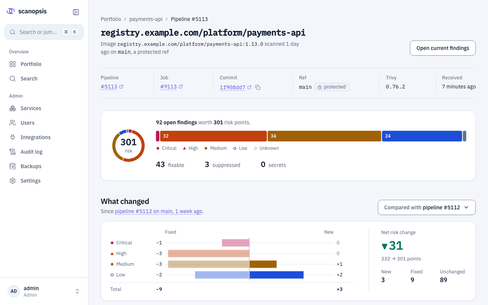

# Use the dashboard

What each page of Scanopsis shows, what its numbers mean, and how to do the
everyday jobs: see what a pipeline changed, find what to fix first, compare two
scans and find a vulnerability across services.

**Audience:** Everyone who uses the dashboard, viewers and admins · **Back to:** [README](../README.md) · [All guides](../README.md#documentation)

---

**Contents:** [Sign in](#sign-in) · [Find your way around](#find-your-way-around) ·
[Words and numbers](#words-and-numbers) · [The portfolio](#the-portfolio) ·
[A service](#a-service) · [Findings](#findings) ·
[Compare two scans](#compare-two-scans) ·
[Find a vulnerability across services](#find-a-vulnerability-across-services) ·
[Theme](#theme) · [Your account](#your-account) ·
[What admins also see](#what-admins-also-see) · [Common jobs](#common-jobs)

Scanopsis shows what your GitLab pipelines report. Trivy results come from the
pipeline's upload job, SonarQube results from SonarQube after each analysis.
Nothing is scanned or analysed by Scanopsis itself. The examples here use the
services `payments-api`, `web-frontend` and `orders-api`.

## Sign in

The sign-in page offers **Sign in with GitLab**, a form for a local account
(**Username**, **Password**, **Sign in**), or both. Your administrator decides
which ones are there.

- **GitLab.** You sign in on your GitLab and come back. The first time, you
  get an account with the role **Viewer**. If the administrator limited
  sign-in to some GitLab groups, you must be a member of one of them.
- **Local account.** The first administrator gets one when Scanopsis is set
  up. Scanopsis has no page to create more local accounts, so everyone else
  signs in with GitLab.

### Two-factor sign-in

Everyone uses two-factor sign-in. The first time you sign in, Scanopsis shows
**Set up two-factor sign-in**:

1. Open an authenticator app on your phone, such as Aegis, 2FAS or Google
   Authenticator, and scan the QR code. If you cannot scan it, type the key
   shown under **Cannot scan it?** into the app, or select **Copy key**.
2. Select **Next** and type the 6-digit code the app shows. The code is sent
   as soon as you type the sixth digit.
3. **Save your recovery codes.** You get 10 codes. Each one signs you in once
   if you lose your phone. They are shown only now: select **Copy all** or
   **Download as text file** and keep them somewhere safe.
4. Tick **I have saved these codes** and select **Continue**.

At every later sign-in, **Enter your code** asks for the current code from the
app. Without your phone, select **Use a recovery code** and type one of your
codes.

After ten wrong codes in a row, Scanopsis signs you out everywhere and says
"Too many wrong codes. Ask an administrator to reset two-factor
authentication." Even the right code is refused until an administrator resets
your two-factor setup; you then set it up again at the next sign-in.

If whoever runs the server gave you a temporary password with the
[`reset-password` command](operations.md#reset-a-password), Scanopsis asks you
to **Choose a new password** right after the code. The new password needs at
least 12 characters and must not be your user name.

## Find your way around

The sidebar on the left has two groups:

- **Overview**: **Portfolio** (all services) and **Search** (a vulnerability
  across services). Everyone sees these.
- **Admin**: **Services**, **Users**, **Integrations**, **Audit log**,
  **Backups** and **Settings**. Only admins see these, see
  [what admins also see](#what-admins-also-see).

The button next to the logo folds the sidebar into a narrow rail. On a phone
the sidebar becomes a bar at the top, with **Open menu**.

At the foot of the sidebar is the **account menu**, with your name and role:
**Your account**, **Theme** (System, Light, Dark), **Keyboard shortcuts** and
**Sign out**.

**Search or jump to**, at the top of the sidebar, opens the command palette.
Type to find a page, a service, a theme or an account action. Type a CVE or
GHSA ID, such as `CVE-2024-3094`, and choose **Search vulnerability** to see
every service that has it.

| Keys | What they do |
| --- | --- |
| Ctrl+K (⌘K on a Mac) | Open the command palette. |
| `/` | Jump to the search field of the page. |
| `?` | Show the keyboard shortcuts. |
| Esc | Close a dialog, menu or panel. |

Filters, sorting and the chosen branch are part of the page address, so you
can bookmark a view or send it to a colleague. Pages do not reload by
themselves: reload the page to see a pipeline that finished since you opened
it. Only two admin pages update themselves: **Integrations** every 30
seconds, and **Backups** every 30 seconds, or every second while a backup or
a restore runs.

## Words and numbers

These words mean the same throughout Scanopsis. Only the scan page of a first
scan counts new findings differently, as the row on new and fixed says.

| Word | Meaning |
| --- | --- |
| **Service** | One GitLab project. A service appears with the first Trivy report its pipeline uploads, or when an admin adds it. |
| **Artifact** | What Trivy scanned: an image, named without its tag (every tag of `registry.example.com/platform/payments-api` is one artifact), or for a secret scan the folder, shown as **Source tree** when it is the whole repository. |
| **Current scan** | The newest scan of each artifact on a branch. Every number about "now" counts the current scans only. |
| **Dashboard branch** | The branch the portfolio and the service page show. An admin chooses it per service. Until then it is the branch with the most recent scan. |
| **Open finding** | A vulnerability in a current scan that is not suppressed. |
| **Fixable** | An open finding for which Trivy reports a fixed version. |
| **Suppressed** | A finding your pipeline told Trivy to ignore, for example in `.trivyignore` or a VEX document. Scanopsis keeps it with the reason, but leaves it out of every count unless you ask for it. |
| **New** and **fixed** | Compared with an earlier scan of the same artifact: **new** findings are in this scan only, **fixed** findings in the earlier scan only. A finding is the same when the vulnerability ID, the package and the target match. The portfolio, the sentence at the top of a service and its **Pipelines** chart treat the first scan of an artifact as the starting point and count nothing in it as new. The scan page of a first scan has nothing to compare with, so it says "First scan of this artifact on this ref: every finding is new." and lists every finding as new. |
| **First seen** | The time of the earliest scan of the same branch and artifact that had the finding. |
| **Quality gate** | SonarQube's verdict on the code: passed or failed. |

### Severity

Trivy gives every vulnerability one of five severities. Scanopsis shows each
with its own colour and its own mark, so they can be told apart without colour
too:

| Severity | Mark | Risk points |
| --- | --- | --- |
| Critical | diamond | 10 |
| High | triangle | 5 |
| Medium | dot | 3 |
| Low | ring | 1 |
| Unknown | dashed ring | 5 |

### Risk points

**Risk** adds up points per open finding, by severity, with the weights of
OWASP Dependency-Track shown above. For example, 1 critical, 32 high,
34 medium, 24 low and 1 unknown finding make
10 + 160 + 102 + 24 + 5 = **301** risk points. Secrets add no points, and
suppressed findings only when you include them on the findings page. Hover
over or focus a risk number to see its arithmetic.

The **risk ring** around a risk number has one segment per severity, sized by
its share of the points. The thin outer ring is the quality gate, in the
colour of passed or failed; the explanation names it.

A change in risk has an arrow: ▲ means more risk (worse), ▼ less risk
(better).

## The portfolio

The portfolio is the home page: every service, ranked by risk, on its
dashboard branch. Archived services are left out.

**Portfolio risk** is the risk of all services together. Next to it is the
change in the last 7 days, and the line under it shows the risk on each day of
the last week. The bar shows the open findings by severity, and the sentence
under it how many there are in how many services. **How it is counted**
explains the sum.

**Needs attention** lists what to look at first:

- how many of the services with a SonarQube analysis fail their quality gate;
- how many services have critical findings;
- how many services have no scan in the last 7 days;
- how many findings have a fixed version, and in how many services.

Select a line to show only those services. **Biggest change in the latest
pipeline** names the service whose last pipeline moved its risk the most.

Below are the controls for the list of services:

- **Search by name or path** finds a service by its name or GitLab path.
- **Sort by**: **Risk** (the default), **Name** or **Freshness**.
- **Cards** or **List**. Scanopsis remembers your choice in this browser. With
  25 or more services, it starts with the list.
- The filters **All**, **Failing gate**, **Has critical**, **Fixable** and
  **Stale** (no scan in the last 7 days), each with its number of services.

Each **card** shows:

- the risk ring and the risk number;
- the service name, its GitLab path and the branch shown;
- the change in risk since the previous pipeline, such as "▼ 31 since #5112";
- the open findings by severity, and how many are fixable;
- a small chart of the findings each recent pipeline added (above the line)
  and fixed (below it). It starts with the second pipeline;
- the quality gate, the coverage, and when the last scan ran. A service
  without a scan in the last 7 days says "Stale".

Select a card to open the service.

## A service

The top of the page sums up the service:

- the **risk ring** and the risk points;
- the name, and the GitLab path, which links to the project in GitLab;
- one sentence on where the service stands, for example "Failing its quality
  gate; 1 critical; 9 fixed and 3 new since pipeline #5112." It names the
  quality gate, the most severe open findings, and what the last pipeline
  fixed and added;
- which branch is shown and why: "the dashboard branch", "the latest scanned
  branch; no dashboard branch is chosen", or "chosen here" when you picked
  it;
- when Trivy last scanned (with a link to the pipeline) and when SonarQube
  last analysed.

**Explore findings** opens the [findings](#findings) of the branch. **Open
pipeline** opens the pipeline in GitLab, **Open in SonarQube** the project in
SonarQube. The branch menu at the top right shows another branch that has
scans.

### Pipelines

The chart shows what each pipeline changed: new findings above the line,
coloured by severity, and fixed findings below it in grey. Above a pipeline, a
tick (passed) or a cross (failed) shows its quality gate. The line under the
bars is the coverage: **Coverage on new code** when the quality gate has a
condition on it, otherwise the overall coverage, labelled **Coverage**. The
dashed line is the coverage the quality gate asks for, when it has such a
condition (in the legend, for example, "Gate 80%").

- **This branch** or **All branches** chooses which pipelines are shown.
- **30 days**, **90 days** or **180 days** chooses the period.
- Select a pipeline to open its scan.

The sentence under the chart adds up the period, for example "13 pipelines on
main in the last 90 days: 34 new and 46 fixed."

### Fix first

The package upgrades that clear the most risk, up to ten. Each line shows the
package, the installed version, the version to upgrade to (the highest fixed
version among its findings), the risk points the upgrade clears, and the
package's open findings by severity. Findings without a fixed version stay
after the upgrade, so the points can be fewer than the findings suggest.
**See every upgrade** opens the full plan, see
[fix by upgrading](#fix-by-upgrading).

### Open findings

The open findings of the branch by severity, with the number that is
**fixable**, the **secrets** and the **suppressed** findings. **Where they
are** splits them into OS packages and language packages. **Artifacts** lists
each scanned image and the source tree, with the pipeline and age of its
latest scan and what it found.

### Code quality

The newest SonarQube analysis of the service, with its pipeline:

- the quality gate, **Passed** or **Failed**, and its **Quality gate
  conditions**: each condition, whether it applies to new code or overall
  code, and the value SonarQube measured;
- **Coverage** of the overall code and of new code, and **Duplication**,
  each with the change since the analysis before;
- the **Ratings (overall code)** for reliability, security, maintainability
  and security review, A (best) to E.

A value SonarQube did not report says "Not available". A service without a
SonarQube project says "No SonarQube project linked"; an admin links it, see
[Connect SonarQube](integrations/sonarqube.md#step-4-link-projects-to-services).

### Recent scans

Every upload of the branch, newest first: the artifact, the kind (**Image** or
**Secret scan**), the pipeline, the commit and what it found. Select a scan to
open it and [compare it](#compare-two-scans).

## Findings

**Explore findings** opens the findings of the branch shown. **Ref** at the top
right switches to another branch. The page has three tabs.

### Vulnerabilities

Every vulnerability in the current scans of the branch. The filters narrow the
list:

- the search field: a package, a vulnerability ID or words of the title;
- **Group by**: **None**, **Package**, **Vulnerability** or **Image**;
- **Severity**: one or more severities;
- **Fix**: **Fixable** or **No fix yet**;
- **Include suppressed**: adds the suppressed findings, each marked
  **Suppressed**. The counts and the risk then include them too;
- **Packages**: **OS packages**, **Language packages** or **Other**, shown
  when the findings come from more than one of these classes;
- **Image**: one or more images, shown when the branch has more than one.

Each filter shows its number of findings. Under the filters, the
summary counts what is left: the findings, their risk points, the share that
is fixable, and the number of packages and images. **Clear filters** removes
every filter. Sort the list by **Severity**, **Vulnerability and package** or
**First seen**.

Select a finding to open its detail panel:

- the severity, its risk points and a link to the **Advisory**;
- for a suppressed finding, the reason, such as "Suppressed: ignored
  (.trivyignore)";
- **Fix**: the installed and the fixed version, and a command to upgrade,
  such as `pip install pip==26.1`. Without a fixed version it says "No fixed
  version yet";
- **Elsewhere**: the other services that have the same vulnerability, and
  **Open in search**;
- **Details**: the image, the full name it was scanned as, the target, the
  package path and type, the class, Trivy's status (such as "Fixed in a newer
  version" or "Will not be fixed"), when it was first seen, and the pipeline
  and job that found it. **Scan details** opens the scan.

### Fix by upgrading

An upgrade plan: the packages to upgrade, ordered by the risk each upgrade
clears, each with the version to move to, the upgrade command and the
vulnerabilities it clears. Point at a package to see how much the plan clears
up to it. Each package goes to the highest fixed version among its findings,
so check the rules of its ecosystem, such as Debian epochs, before you
upgrade. Suppressed findings are left out.

### Secrets

The secrets Trivy found: the rule, the file and line, and the scan that found
them. Scanopsis never stores the matched value, so it shows dots and "Value not
stored". Rotate a leaked credential, then remove it from the history.

## Compare two scans

Open a scan from **Recent scans**, from a pipeline in the chart, or with **Scan
details** in a finding's detail panel. The scan page shows:

- the facts: **Pipeline**, **Job**, **Commit** (with a copy button), **Ref**
  (with "protected" for a protected branch or tag), the **Trivy** version and
  when Scanopsis **Received** it;
- the scan's open findings by severity, its risk, and how many are fixable,
  suppressed and secrets;
- **What changed**: the fixed and new findings per severity, the **Net risk
  change**, and the tabs **New**, **Fixed** and **Unchanged** with the
  findings themselves.

Scanopsis compares with the previous scan of the same artifact on the same
branch. To compare with another one, open **Compared with** and choose any
earlier scan of the same artifact. The previous one is marked **Previous**.
Tick **Only** with the branch name to hide the scans of other branches, and
select **Show older scans** to go further back.

**Open current findings** opens the findings of the branch as they are now.

## Find a vulnerability across services

Open **Search**, type a vulnerability ID, such as `CVE-2024-3094` or
`GHSA-jfh8-c2jp-5v3q`, and press Enter. The ID has 3 to 100 characters:
letters, digits and `-` `_` `:` `.`.

**Search in** chooses where to look:

- **Dashboard branches and protected refs** (the default): the dashboard
  branch of every service, and every protected branch and tag.
- **All branches**: every branch of every service.

The answer starts with the vulnerability: its severity, title, the fixed
version and a link to the advisory, then the number of services, images and
findings. Below, each service lists the branch, the image, the package with
its fixed version, the severity and when it was scanned. **Open findings**
opens the service's findings for that vulnerability.

Only current scans count. Suppressed findings and archived services are left
out. At most 1,000 findings are listed, the most severe first; the totals
count every match.

## Theme

Scanopsis has a light and a dark theme. Choose **System** (follow your device,
the default), **Light** or **Dark** in any of these places:

- **Theme** in the account menu;
- **Appearance** on [your account page](#your-account);
- the command palette: **Use the dark theme**, **Use the light theme**, **Use
  the system theme**;
- the three buttons at the top right of the sign-in pages.

The choice is saved in this browser.

## Your account

Open **Your account** in the account menu. It shows:

- **Signs in with** (GitLab or a local password), your **Role** (Admin or
  Viewer), whether **Two-factor** is on, and since when you are a member.
- **Sessions**: every browser where you are signed in, with its address and
  when it signed in and was last active. **This browser** marks the one you
  use. **End session** signs out another browser, and **End all other
  sessions** signs out every browser but this one. A session also ends when
  its browser closes, after it stays unused for the idle timeout (30 minutes
  by default), and at the latest at the longest session time after sign-in
  (12 hours by default). An admin can change both in Settings.
- **Appearance**: the theme.

The account page cannot change your password or your two-factor setup:

- **GitLab users** change their password in GitLab.
- **Lost phone, recovery codes left:** sign in with a recovery code.
- **Lost phone, no recovery code left, or new recovery codes wanted:** ask an
  admin to reset your two-factor setup. You set it up again at the next
  sign-in and get 10 new codes.
- **Forgotten local password:** whoever runs the server gives you a
  temporary password with the
  [`reset-password` command](operations.md#reset-a-password). You replace it
  at the next sign-in.

## What admins also see

Admins see everything a viewer sees, plus the **Admin** pages. This is a short
tour; the linked guides give the steps.

- **Services**: every service with its **Dashboard branch**, its **SonarQube
  key**, its last scan and who added it, under **Active** and **Archived**.
  Select the branch tag to choose the dashboard branch. The actions menu of a
  service has **Edit** (name and SonarQube key), **Choose dashboard branch**,
  **Archive** (or **Unarchive**) and **Delete**. **Add service** adds a
  service before its first upload. An archived service leaves the portfolio
  and its uploads are refused; its history stays. Delete removes all its scans
  and analyses. An archive or delete waits until an upload of the service that
  is in progress has stored its scan; storing a report of 20 MB took 0.3 to
  1.1 seconds in the project's tests. If you delete a service
  while its pipeline uploads, that upload creates the service again and stores
  its scan; the pipeline does not fail. See
  [choose the dashboard branch](operations.md#choose-the-dashboard-branch-of-a-service)
  and [link projects to services](integrations/sonarqube.md#step-4-link-projects-to-services).
- **Users**: everyone who has signed in, with the sign-in method, the role,
  whether two-factor is on and the last sign-in. Change a role in the **Role**
  menu, or with **Make admin** or **Make viewer** in the actions menu (**⋯**),
  which is the way on a narrow screen, where the **Role** column is hidden.
  The actions menu also has **Reset two-factor**, **Disable user** (or
  **Enable user**) and **Delete user**. See
  [disable, enable or delete a user](operations.md#disable-enable-or-delete-a-user)
  and [recovering access](operations.md#recovering-access-when-locked-out).
- **Integrations**: whether Trivy uploads and SonarQube analyses arrive, the
  uploads per day, the refused uploads with the reason, and the recent
  SonarQube deliveries. See [the GitLab CI guide](integrations/gitlab-ci.md)
  and [Connect SonarQube](integrations/sonarqube.md).
- **Audit log**: who did what and when, filtered by **Action** and **Actor**.
  See [read the audit log](operations.md#read-the-audit-log).
- **Backups**: back up now, schedule backups, upload, download and restore.
  See [backup and restore](operations.md#backup-and-restore).
- **Settings**: GitLab, sign-in, sessions, SonarQube, scan uploads and
  retention. Changes apply when you save, without a restart. See the
  [configuration reference](configuration.md).

## Common jobs

| You want to | Do this |
| --- | --- |
| See which services need attention | Open **Portfolio** and read **Needs attention**. Select a line to filter. |
| See what the last pipeline changed | Open the service. The sentence at the top gives the new and fixed findings; the last bar of **Pipelines** shows them by severity. Select it to see each finding. |
| Know what to fix first | Read **Fix first** on the service page, or the **Fix by upgrading** tab of its findings. |
| See why a finding is suppressed | In the findings, tick **Include suppressed** and open the finding. The reason is under its severity. |
| Compare two scans | Open a scan from **Recent scans**, then choose another one in **Compared with**. |
| Find a CVE across services | Open **Search**, or press Ctrl+K (⌘K) and type the ID. |
| Check a number against Trivy or SonarQube | Follow [verifying the numbers](verification.md). |
| Switch to the dark theme | Account menu, **Theme**, **Dark**. |
| Sign out every other browser | **Your account**, **End all other sessions**. |

---

[Back to the README](../README.md) · [All guides](../README.md#documentation) · Found a mistake? [Open an issue](https://github.com/siyamsarker/scanopsis/issues)
